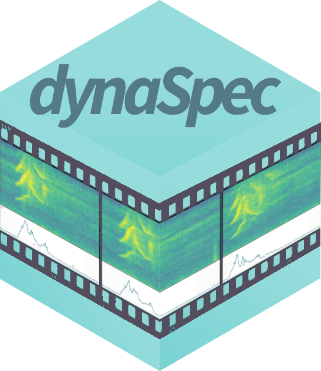

dynaSpec: dynamic spectrogram visualizations
================

<!-- the website home page (pkgdown/index.md) is created from README.md by pkgdown/make_index.R (run automatically in the pkgdown GitHub Actions workflow) -->

<!-- README.md is generated from README.Rmd. Please edit that file -->

<!-- badges: start -->

[](https://github.com/maRce10/dynaSpec/actions/workflows/R-CMD-check.yaml)
[](https://github.com/maRce10/dynaSpec/actions/workflows/pkgdown.yaml)
[](https://app.codecov.io/gh/maRce10/dynaSpec)
[](https://cran.r-project.org/web/checks/check_results_dynaSpec.html)
[](https://lifecycle.r-lib.org/articles/stages.html)
[](https://www.repostatus.org/#active)

[](https://cran.r-project.org/package=dynaSpec)
[](https://cran.r-project.org/package=dynaSpec)
[](https://marce10.r-universe.dev/dynaSpec)
[](https://cranlogs.r-pkg.org/downloads/total/last-month/dynaSpec)
[](https://cranlogs.r-pkg.org/downloads/total/2015-01-01:last-day/dynaSpec)

[](https://www.gnu.org/licenses/old-licenses/gpl-2.0.html)
[](https://cran.r-project.org/)
[](https://marce10.github.io/dynaSpec/)
[](https://github.com/maRce10/dynaSpec/commits/master)
<!-- badges: end -->



**dynaSpec** creates dynamic spectrograms: videos (mp4) of spectrograms
synchronized with the sound, ready for presentations, teaching or
sharing online, *without taking screen recordings* of another program.
It builds on [seewave](https://CRAN.R-project.org/package=seewave) and
[tuneR](https://CRAN.R-project.org/package=tuneR).

The package offers two styles of dynamic spectrogram:

| Style | Functions | What it looks like |
|----|----|----|
| [Scrolling](https://marce10.github.io/dynaSpec/articles/dynaSpec.html#scrolling-dynamic-spectrograms) | `scrolling_spectro()` | The spectrogram scrolls from right to left past a fixed “play” line, as in the Macaulay Library. Built with base graphics; supports oscillograms, looping, slow motion, annotations and custom spectrogram functions |
| [Paged](https://marce10.github.io/dynaSpec/articles/dynaSpec.html#paged-dynamic-spectrograms) | `prep_static_ggspectro()` + `paged_spectro()` | A static spectrogram (or several “pages”) revealed by a sliding highlight box, as in Adobe Audition’s spectral view. Built with ggplot2 |

**Contents:** [Installation](#installation) · [Quick
start](#quick-start) · [Background](#background) · [Examples](#examples)
· [Citation](#citation)

> 📖 **Examples with videos for both styles are in the vignette
> [Creating dynamic
> spectrograms](https://marce10.github.io/dynaSpec/articles/dynaSpec.html)**
> (or run `vignette("dynaSpec")` in R).

## Installation

Install the package from CRAN:

``` r
install.packages("dynaSpec")
```

or the development version from GitHub (requires
[remotes](https://cran.r-project.org/package=remotes)):

``` r
remotes::install_github("maRce10/dynaSpec")
```

### ffmpeg

dynaSpec uses [ffmpeg](https://ffmpeg.org/download.html) to encode the
videos, so it must be installed and available in the system path:

| Operating system | Command (in a terminal) |
|----|----|
| Windows | `winget install --id Gyan.FFmpeg -e` (or download a build from [gyan.dev](https://www.gyan.dev/ffmpeg/builds/) and add its `bin` folder to the PATH; see [this issue](https://github.com/maRce10/dynaSpec/issues/3) for troubleshooting) |
| macOS | `brew install ffmpeg` |
| Debian/Ubuntu | `sudo apt install ffmpeg` |

You can check that R finds it with:

``` r
Sys.which("ffmpeg")
```

If ffmpeg is installed somewhere else, point R to the executable with
`Sys.setenv(ffmpeg = "path/to/ffmpeg")`. Paged spectrograms also need
the [av](https://CRAN.R-project.org/package=av) package
(`install.packages("av")`).

If installing external dependencies is a problem, you can run dynaSpec
in Google Colab. This [colab
notebook](https://colab.research.google.com/github/maRce10/dynaSpec/blob/master/dynaSpec.ipynb)
explains how to do it step by step.

## Quick start

``` r
library(dynaSpec)

# example recording included in the package
data("canyon_wren")

# scrolling spectrogram (saved as "canyon_wren.mp4" in the working directory)
scrolling_spectro(wave = canyon_wren, wl = 300, flim = c(1, 9), file.name = "canyon_wren.mp4")

# paged spectrogram of one of the example sound files
wav <- system.file("femaleBarnSwallow.wav", package = "dynaSpec")
params <- prep_static_ggspectro(wav, destFolder = tempdir(), onlyPlotSpec = FALSE)
paged_spectro(params)
```

Videos are played automatically when they are ready (use `play = FALSE`
to turn this off). Invalid arguments are reported all together before
any processing starts, so mistakes are caught early. See the
[vignette](https://marce10.github.io/dynaSpec/articles/dynaSpec.html)
for many more options and examples.

## Background

This package is a collaboration between [Marcelo
Araya-Salas](https://marce10.github.io/) and [Matt
Wilkins](https://www.mattwilkinsbio.com/). The goal is to create static
and dynamic visualizations of sounds, ready for publication or
presentation. Marcelo’s approach (`scrolling_spectro()`) shows a
spectrogram sliding past a fixed point as sounds are played, similar to
that used in Cornell’s Macaulay Library. These dynamic spectrograms are
produced with base graphics. Matt’s approach creates “paged”
spectrograms that are revealed by a sliding highlight box as sounds are
played, akin to Adobe Audition’s spectral view. It is built on ggplot2,
and requires setting up spectrogram parameters and segmenting sound
files with `prep_static_ggspectro()`, the result of which is processed
with `paged_spectro()` to generate the video.

------------------------------------------------------------------------

## Examples

Detailed examples of both approaches, with the resulting videos, are in
the vignette [Creating dynamic
spectrograms](https://marce10.github.io/dynaSpec/articles/dynaSpec.html)
(also available from R with `vignette("dynaSpec")`; when installing from
GitHub use
`remotes::install_github("maRce10/dynaSpec", build_vignettes = TRUE)`).
They cover:

- **Scrolling spectrograms:** color palettes and backgrounds, slow
  motion, oscillograms, looping, removing axes, recordings from
  Xeno-Canto, very short (bat) calls, custom spectrogram functions
  (e.g. highlighting male and female parts of a duet with
  `warbleR::color_spectro()`) and text annotations
- **Paged spectrograms:** static and dynamic spectrograms with and
  without axes, brightening quiet sounds, multi-page videos from long
  recordings (humpback whale song) and MP3 files from Xeno-Canto with
  custom color schemes

A taste of what you can do:

<https://github.com/user-attachments/assets/8323b6cd-8ddd-4d4f-9e42-4adad90f2c74>

------------------------------------------------------------------------

## Citation

Please cite [dynaSpec](https://marce10.github.io/dynaSpec/) as follows:

Araya-Salas, M. & Wilkins, M. R. (2020). *dynaSpec: dynamic spectrogram
visualizations in R*. R package version 1.1.0.
<https://marce10.github.io/dynaSpec/>

(also available from R with `citation("dynaSpec")`)

Bugs and feature requests can be reported at
<https://github.com/maRce10/dynaSpec/issues>.
