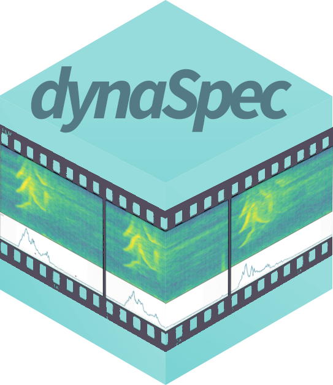
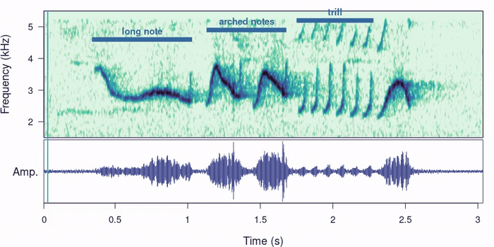
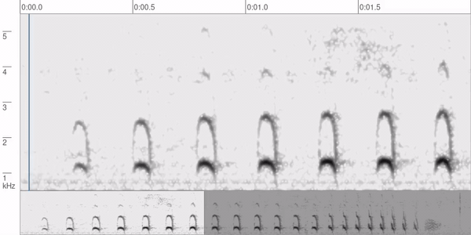
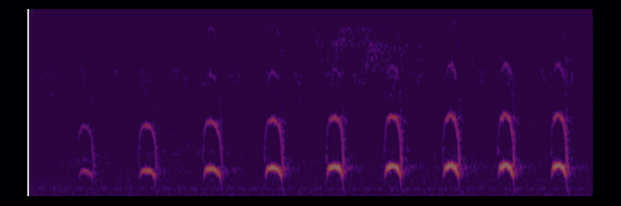

dynaSpec: dynamic spectrogram visualizations
================

<!-- the website home page (pkgdown/index.md) is created from README.md by pkgdown/make_index.R (run automatically in the pkgdown GitHub Actions workflow) -->

<!-- README.md is generated from README.Rmd. Please edit that file -->

<!-- badges: start -->

[](https://github.com/maRce10/dynaSpec/actions/workflows/R-CMD-check.yaml)
[](https://lifecycle.r-lib.org/articles/stages.html)
[](https://www.repostatus.org/#wip)
[](https://www.gnu.org/licenses/old-licenses/gpl-2.0.html)
[](https://cran.r-project.org/)
<!-- badges: end -->



**dynaSpec** creates dynamic spectrograms: spectrograms that move along
with the sound, ready for presentations, teaching or sharing online,
*without taking screen recordings* of another program. They are shown as
interactive web pages (with the sound embedded, click-to-play and
buttons to slow the sound down), which work in R Markdown and Quarto
documents, and can also be saved as videos (mp4). It builds on
[seewave](https://CRAN.R-project.org/package=seewave) and
[tuneR](https://CRAN.R-project.org/package=tuneR).

Dynamic spectrograms are built in layers, as ‘ggplot2’ graphs:
`dynaspec()` takes the sound, and layers are added with `+` (only the
panels added are shown):

| Layer | What it does |
|----|----|
| `ds_spectrogram()` | Adds a spectrogram (window length, palette, amplitude range, …) |
| `ds_oscillogram()`, `ds_envelope()` | Add an oscillogram or an amplitude envelope (above or below the spectrogram) |
| `ds_spectrum()` | Adds a power spectrum next to the spectrogram |
| `ds_overview()` | Adds a lower panel with the whole sound to scrolling spectrograms |
| `ds_annotations()` | Highlights parts of the sound with translucent boxes, borders and labels (e.g. from a selection table) |
| `ds_captions()` | Text at a fixed position shown during a time range, like subtitles |
| `ds_theme()`, `ds_theme_dark()`, … | Axis titles, fonts, colors of the figure and plot, and preset themes |
| `ds_player()` | Playback controls of web pages (speed slider, loop, volume, download, …) |
| `ds_static()`, `ds_scrolling()` or `ds_paged()` | Style of the dynamic spectrogram (see below) |

The package offers three styles of dynamic spectrogram:

| Style | What it looks like |
|----|----|
| Static (`ds_static()`, default) | A play line moves over the whole spectrogram (and oscillogram), which can be split in several rows |
| Scrolling (`ds_scrolling()`) | The spectrogram scrolls from right to left past a fixed “play” line, as in the Macaulay Library |
| Paged (`ds_paged()`) | A spectrogram (or several “pages”) revealed by a sliding highlight box, as in Adobe Audition’s spectral view |

### What it looks like

The previews below are silent animations made from videos saved with
`save_dynaspec()` (in R, printing the objects shows interactive web
pages with sound).

**Static spectrogram** with an oscillogram, annotation lines and the
‘mako’ theme:

``` r
st <- data.frame(start = c(0.34, 1.13, 1.75, 2.34), end = c(1.03, 1.68, 2.33, 2.55),
                 labels = c("long note", "arched notes", "trill", "end note"), y = c(4.6, 4.9, 5.4, 4))

dynaspec(scythebill, flim = c(1.5, Inf)) +
  ds_spectrogram(wl = 200, collevels = seq(-50, 0, 1)) +
  ds_oscillogram() +
  ds_annotations(st, type = "line", line.freq = "y", labels = "labels") +
  ds_theme_mako()
```



**Scrolling spectrogram** with an overview of the whole sound and the
Macaulay Library look:

``` r
dynaspec(antshrike, flim = c(0.5, 5.5), tlim = c(0.1, 5)) +
  ds_spectrogram(wl = 256, collevels = seq(-50, 0, 1)) +
  ds_overview() +
  ds_theme_macaulay() +
  ds_scrolling(t.display = 2, fix.time = FALSE)
```



**Paged spectrogram**, revealed by a sliding highlight box:

``` r
dynaspec(antshrike, flim = c(0.5, 5.5), tlim = c(0.1, 5)) +
  ds_spectrogram(wl = 256, collevels = seq(-50, 0, 1)) +
  ds_paged(t.display = 2.5)
```



<!-- a GitHub alert box (raw markdown, so pandoc keeps it; pkgdown/make_index.R turns it into a Bootstrap alert) -->

> [!TIP]
> **Vignette and articles** (on the [package website](https://marce10.github.io/dynaSpec/)):
>
> - [Creating dynamic spectrograms](https://marce10.github.io/dynaSpec/articles/dynaSpec.html) (vignette; also `vignette("dynaSpec")` in R): basic usage of every layer and of the three styles, and how to save and embed them
> - [Themes for dynamic spectrograms](https://marce10.github.io/dynaSpec/articles/themes.html): theme settings and preset themes, including looks inspired by the Xeno-canto and Macaulay Library players
> - [Customizing dynamic spectrograms](https://marce10.github.io/dynaSpec/articles/customizing.html): spectrograms, panels, styles, annotations, captions, player controls and videos

## Installation

Install latest version from CRAN:

``` r
install.packages("dynaSpec")
```

Or install the development version from GitHub (requires
[remotes](https://cran.r-project.org/package=remotes)):

``` r
remotes::install_github("maRce10/dynaSpec")
```

### ffmpeg

Web pages do not need any external software. However, to create videos
dynaSpec uses [ffmpeg](https://ffmpeg.org/download.html), which must be
installed and available in the system path:

| Operating system | Command (in a terminal) |
|----|----|
| Windows | `winget install --id Gyan.FFmpeg -e` (or download a build from [gyan.dev](https://www.gyan.dev/ffmpeg/builds/) and add its `bin` folder to the PATH) |
| macOS | `brew install ffmpeg` |
| Debian/Ubuntu | `sudo apt install ffmpeg` |

You can check that R finds it with:

``` r
Sys.which("ffmpeg")
```

If ffmpeg is installed somewhere else, point R to the executable with
`Sys.setenv(ffmpeg = "path/to/ffmpeg")`.

------------------------------------------------------------------------

## Citation

Please cite dynaSpec as follows:

Araya-Salas, M. & Wilkins, M. R. (2026). *dynaSpec: dynamic spectrogram
visualizations in R*. R package version 2.0.0.9000.
<https://github.com/maRce10/dynaSpec>

Bugs and feature requests can be reported at
<https://github.com/maRce10/dynaSpec/issues>.
